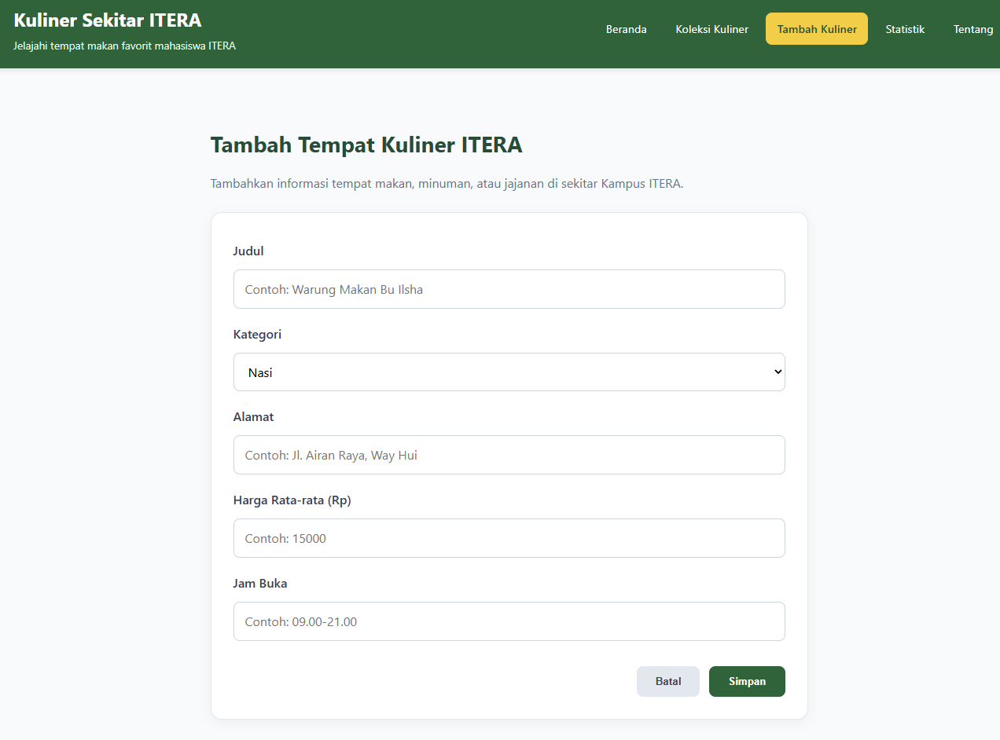
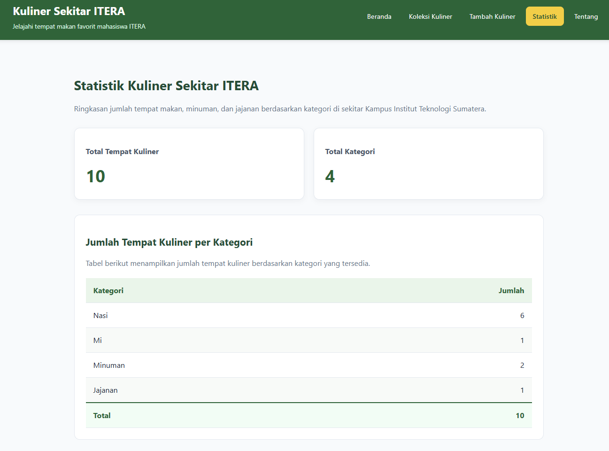
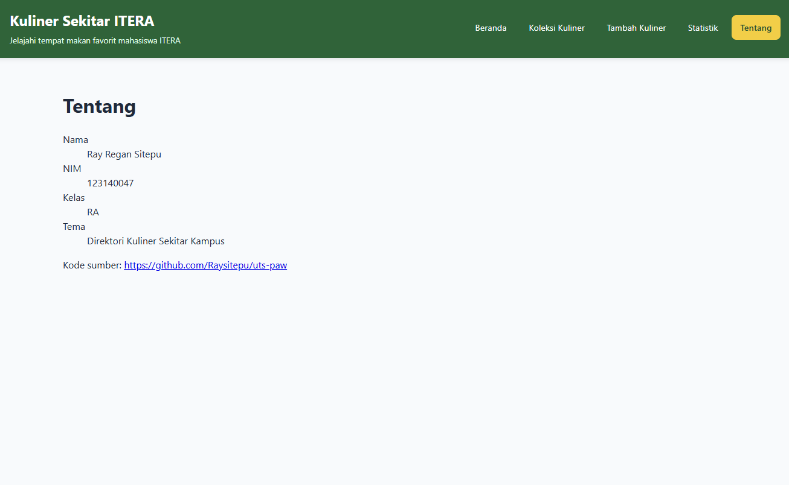

# Ujian Tengah Semester IF25-22014 Pengembangan Aplikasi Web

# Direktori Kuliner Sekitar Kampus ITERA

Aplikasi berbasis web untuk membantu mahasiswa dan masyarakat menemukan informasi tempat makan, minuman, dan jajanan di sekitar Kampus Institut Teknologi Sumatera (ITERA).

## Identitas Mahasiswa

- **Nama:** Ray Regan Sitepu
- **NIM:** 123140047
- **Kelas:** RA
- **Mata Kuliah:** Pengembangan Aplikasi Web
- **Tema:** Direktori Kuliner Sekitar Kampus

## Tautan Aplikasi

**Deployment:** https://raysitepu.github.io/uts-paw/

**Repository GitHub:** https://github.com/Raysitepu/uts-paw

## Tangkapan Layar
### Beranda


### Koleksi Kuliner


### Tambah Kuliner


### Statistik


### Tentang

## Fitur Aplikasi

1. **Beranda:** Menampilkan informasi dan ringkasan direktori kuliner sekitar ITERA.
2. **Koleksi Kuliner:** Menampilkan daftar tempat makan berdasarkan data yang tersedia.
3. **Pencarian dan Filter:** Mencari tempat kuliner berdasarkan nama dan menyaring berdasarkan kategori.
4. **Detail Kuliner:** Menampilkan nama, kategori, alamat, harga rata-rata, dan jam buka.
5. **Tambah Kuliner:** Menambahkan data tempat kuliner baru melalui formulir.
6. **Hapus Kuliner:** Menghapus data tempat kuliner dengan konfirmasi.
7. **Statistik:** Menampilkan jumlah tempat kuliner berdasarkan kategori.
8. **Tentang:** Menampilkan informasi aplikasi dan identitas pengembang.
9. **Halaman 404:** Menampilkan pesan ketika pengguna membuka halaman yang tidak tersedia.

## Teknologi yang Digunakan

- React JS
- JavaScript
- HTML dan CSS
- React Router
- Context API
- Custom Hooks
- LocalStorage
- Vite
- GitHub Pages

## Menjalankan Aplikasi Secara Lokal

Pastikan Node.js dan npm telah terpasang.

```bash
git clone https://github.com/Raysitepu/uts-paw.git
cd uts-paw/app
npm install
npm run dev
```

Buka alamat localhost yang ditampilkan oleh Vite untuk mengakses aplikasi.

## Pengujian

Untuk memeriksa kualitas kode, proses build, dan hasil pengujian:

```bash
npm run lint
npm run build
npm test
npm run cek
```

## Sumber Data

Data awal tempat kuliner disimpan dalam berkas `app/public/data/koleksi.json`, dengan minimal 10 tempat kuliner di sekitar Kampus ITERA.

Perubahan data melalui aplikasi disimpan menggunakan LocalStorage.

## Informasi Proyek

Proyek ini dikembangkan sebagai tugas Ujian Tengah Semester mata kuliah Pengembangan Aplikasi Web, Program Studi Teknik Informatika, Institut Teknologi Sumatera.
